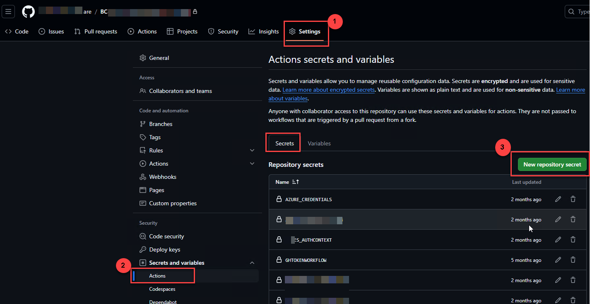
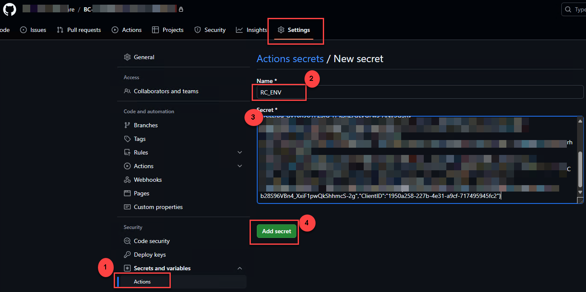
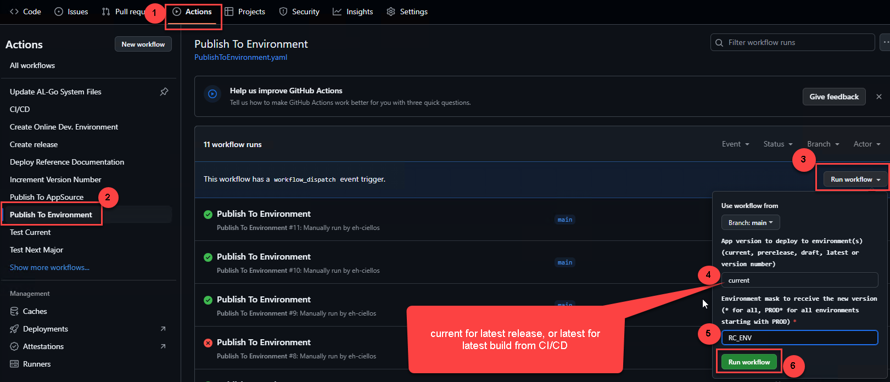

# AUTHCONTEXT

AL-Go for GitHub needs an **AuthContext** secret every time it deploys apps to a Business Central online environment: in the `CI/CD` workflow and in the **Publish To Environment** workflow.

AuthContext is only used for deploying to BC environments. Delivery of an AppSource app to Partner Center uses a different secret, `AppSourceContext`. See [AL-Go secrets: AppSourceContext](https://github.com/microsoft/AL-Go/blob/main/Scenarios/secrets.md#appsourcecontext).

## Step 1. Choose the authentication type

There are two ways to authenticate. Which one fits depends on the type of the repository (`"type"` in `.github/AL-Go-Settings.json`) and on the target environment.

| | **A. Impersonation** (device login, refresh token) | **B. Service-to-service (S2S)** (Entra app registration) |
| --- | --- | --- |
| Acts as | The BC user who signed in | The Entra application, registered as a user in BC |
| Secret expires | About **every 90 days**, then it has to be recreated | Client secret: when the secret expires (you choose the lifetime in Entra). Federated credential: no secret to rotate |
| Tied to a person | Yes. The deploy stops working if that user leaves or loses access | No |
| Setup in BC | A user with permission to deploy extensions | **Microsoft Entra Applications** card with the `D365 AUTOMATION` and `EXTEN. MGT. - ADMIN` permission sets |
| **PTE repo → sandbox** | Development endpoint: apps are installed in the **Dev** scope | Automation API: apps are installed as a **PTE** (global scope) |
| **PTE repo → production** | Automation API: installed as PTE | Automation API: installed as PTE |
| **AppSource repo → sandbox** | Development endpoint: **Dev** scope | Development endpoint: **Dev** scope (see the note below) |
| **AppSource repo → production** | Not possible. Customers receive the app through AppSource | Not possible. Customers receive the app through AppSource |

How AL-Go chooses the publishing method (from [`Actions/Deploy/Deploy.ps1`](https://github.com/microsoft/AL-Go/blob/main/Actions/Deploy/Deploy.ps1)):

- A repository of type `AppSource App` is **always** published through the development endpoint (Dev scope). The development endpoint only works for sandbox environments. A deployment of an AppSource app to a production environment fails with `Scope Dev is only valid for sandbox environments`.
- A `PTE` repository goes through the development endpoint only when the environment is a sandbox **and** the AuthContext is impersonation. With S2S, or for a production environment, it uses the Automation API and installs the app as a PTE.
- You can override this per environment with `"Scope": "Dev"` or `"Scope": "PTE"` in the `DeployTo<EnvironmentName>` setting.

> [!NOTE]
> **AppSource repo with S2S.** The AL-Go documentation describes the development endpoint as the path for non-S2S authentication. Publishing through the development endpoint with an S2S token is not described there. For AppSource repositories use **impersonation (A)** unless you have verified S2S against your own sandbox.

> [!WARNING]
> **PTE repo, sandbox, S2S.** The app is installed as a PTE, not in the Dev scope. A developer can then no longer publish the same app (same App ID) from VS Code to that sandbox until the PTE is uninstalled. If developers also use this sandbox from VS Code, either use impersonation for it or set `"Scope": "Dev"`.

### Recommendation

| Repository type | Environment | Use |
| --- | --- | --- |
| PTE | TEST / UAT sandboxes that only CI/CD deploys to | **B. S2S** |
| PTE | Sandbox that developers also publish to from VS Code | **A. Impersonation**, or B with `"Scope": "Dev"` |
| PTE | Production | **B. S2S** |
| AppSource | Sandboxes | **A. Impersonation** |
| AppSource | Production | No AuthContext. Delivery goes through AppSource (`AppSourceContext`) |

## Step 2. Choose the secret name

AL-Go looks for the secret under these names, in this order, and uses the first one that has a value:

1. `<EnvironmentName>-AuthContext`
2. `<EnvironmentName>_AuthContext`
3. `AuthContext` (shared fallback for all environments)

`<EnvironmentName>` is the name of the **GitHub environment** (the name in Settings -> Environments, or in the `environments` setting), for example `TEST_AuthContext`. It is not the BC environment name when the two differ: with a GitHub environment `MyProject_Test` and `"DeployToMyProject_Test": { "EnvironmentName": "TEST" }`, the repository secret is `MyProject_Test_AuthContext`. GitHub secret names cannot contain hyphens; for a GitHub environment named `MyProject-Test`, use the environment-scoped `AUTHCONTEXT` alternative below instead. Use one secret per environment. If a per-environment secret is missing, AL-Go **silently** falls back to the shared `AuthContext` secret, and the environment is deployed with the wrong credentials.

The secret can also be stored as a secret named `AUTHCONTEXT` inside a **GitHub Environment** with the same name. GitHub Environments in private repositories need a paid GitHub plan. On the free plan, use repository secrets.

To create a repository secret, open the repository and go to **Settings** -> **Secrets and variables** -> **Actions** -> **New repository secret**:

|  |
|-|

> [!IMPORTANT]
> The secret value must be **compressed JSON on a single line**. GitHub masks every line of a secret in the logs separately. A multi-line JSON value makes the lone `{` and `}` lines secrets too, and that breaks AL-Go.

## Option A. Impersonation (device login)

The easiest way to create an authentication context with impersonation is the following PowerShell script on a machine with the latest **BcContainerHelper** module. If the module is already installed, the last three lines are enough:

```powershell
#Check ExecutionPolicy
$AllowedPolicies = @("Bypass", "RemoteSigned", "Unrestricted")
$ExecutionPolicy = Get-ExecutionPolicy -Scope Process
if ($ExecutionPolicy -notin $AllowedPolicies) {
    # Set ExecutionPolicy to Bypass if not already set to one of the allowed policies
    Set-ExecutionPolicy -ExecutionPolicy Bypass -Scope Process -Force
}
Install-Module BcContainerHelper -Force -Scope CurrentUser -Verbose
Import-Module BcContainerHelper -Scope Local -Force

$tenantId = '{{Your-TenantId}}'
# Impersonation: sign in as a BC user, the result is a refresh token valid for about 90 days
New-BcAuthContext -includeDeviceLogin -tenantID $tenantId | New-ALGoAuthContext | Set-Clipboard
```

The command displays the well-known device login text: **To sign in, use a web browser to open the page https://microsoft.com/devicelogin and enter the code XXXXXXX to authenticate.**

Complete the login with a Business Central user who has access to deploy apps to the environment. The authorization context is generated and copied to your clipboard as compressed JSON:

`{"tenantId":"<tenantId>","scopes":"https://api.businesscentral.dynamics.com/","RefreshToken":"<refreshToken>","clientId":"<clientId>"}`

Paste it into the **Value** field of the secret and choose **Add secret**:

|  |
|-|

> [!NOTE]
> The refresh token gives access for about **90 days**. After that, run the script again and replace the secret value. Anyone who has the refresh token can call the BC API as that user, also outside GitHub.

## Option B. Service-to-service (S2S)

### B.1. Register the application in Microsoft Entra ID

1. In the [Microsoft Entra admin center](https://entra.microsoft.com), register a new application in the customer's tenant (**App registrations** -> **New registration**).
2. Under **API permissions**, add **Dynamics 365 Business Central** -> **Application permissions**: `API.ReadWrite.All` and `Automation.ReadWrite.All`. Choose **Grant admin consent**.
3. Note the **Application (client) ID** and the **Directory (tenant) ID**.

Details: [Using service-to-service (S2S) authentication](https://learn.microsoft.com/dynamics365/business-central/dev-itpro/administration/automation-apis-using-s2s-authentication).

### B.2. Register the application in Business Central

Repeat this in **every** environment that AL-Go deploys to:

1. Search for **Microsoft Entra Applications** and choose **New**.
2. Enter the **Client ID** from step B.1 and a **Description** that identifies the partner and the purpose (for example `Ciellos AL-Go deployment`).
3. Set **State** to **Enabled**.
4. Assign the permission sets `D365 AUTOMATION` and `EXTEN. MGT. - ADMIN`.

### B.3. Create the secret

Pick one of the two variants.

**Client secret.** Under **Certificates & secrets** in the app registration, create a client secret and note its value and expiry date. Set a reminder to renew it before it expires. The AuthContext secret value is:

`{"tenantId":"<tenantId>","scopes":"https://api.businesscentral.dynamics.com/","clientId":"<clientId>","clientSecret":"<clientSecret>"}`

Anyone who has the client ID and the client secret can act as this application in Business Central.

**Federated credential (no stored secret).** Under **Certificates & secrets** -> **Federated credentials**, add a credential for **GitHub Actions deploying Azure resources**, with your organization, repository and the branch or GitHub Environment that deploys. AL-Go then authenticates with a GitHub-issued ID token, and only workflows from that branch or environment can sign in. The AuthContext secret value has no secret in it:

`{"tenantId":"<tenantId>","scopes":"https://api.businesscentral.dynamics.com/","clientId":"<clientId>"}`

Details: [AL-Go secrets: AuthContext](https://github.com/microsoft/AL-Go/blob/main/Scenarios/secrets.md#authcontext).

## Step 3. Test the deployment

Select **Actions** -> **Publish To Environment**, enter the name of your environment and choose **Run workflow**. Inspect the workflow and check that it deploys your apps:

|  |
|-|

The URL under the deployment opens the environment.

In the Business Central environment, open **Extension Management** to see the installed apps. The scope depends on the table in [Step 1](#step-1-choose-the-authentication-type): **Dev** for the development endpoint, **Global** (PTE) for the Automation API.

|  |
|-|
