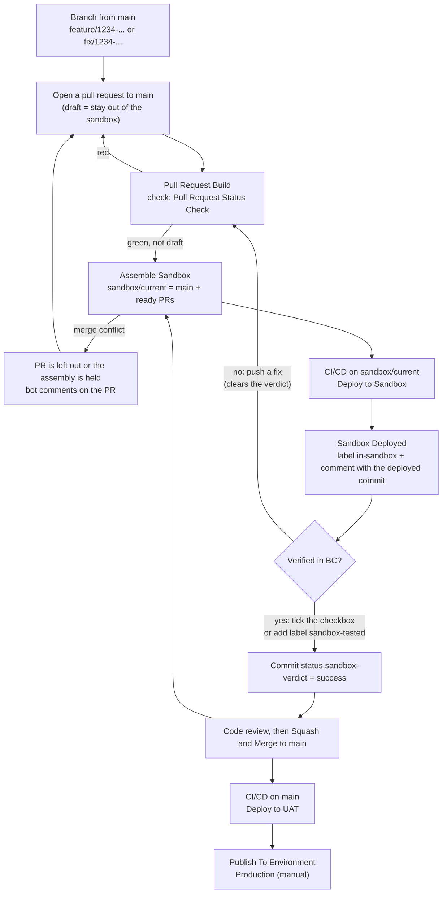

# Sandbox Assembly Flow

An alternative to the [AL-Go Git Flow](BranchFlow.md). Every open pull request is deployed to one shared BC **Sandbox** *before* it is merged, and a person confirms in BC that it works. Only then does the pull request go to `main`.

## The idea in one paragraph

A bot keeps a branch called `sandbox/current` that is always **`main` plus every open pull request that is ready**. The branch is rebuilt from scratch and force-pushed whenever that set may have changed. AL-Go's `CI/CD` builds the branch and deploys it to the Sandbox environment. Testers and consultants therefore see all the work in progress in one place, side by side, without anyone merging unfinished code into `main`. Nobody commits to `sandbox/current`; it is output, never input.

### No more competing for the sandbox

Without this flow, developers who share one sandbox take turns: each one publishes their own branch from VS Code to test it, and that **replaces the version the previous developer published**. A tester who is in the middle of checking feature A suddenly looks at feature B, or at a build without A. Developers end up agreeing in chat who may use the sandbox and when, and features wait for each other.

Here nobody publishes to the Sandbox by hand. Every ready pull request is in it **at the same time**, merged together on top of `main`, and the bot is the only one that deploys. A developer opens a pull request and the change appears in the Sandbox next to everyone else's; nothing anyone else is testing disappears. Each pull request is told which of its commits is deployed, so testers know exactly what they are looking at.

## How it differs from the AL-Go Git Flow

| | [AL-Go Git Flow](BranchFlow.md) | Sandbox Assembly Flow |
| --- | --- | --- |
| Where a change is tested in BC | TEST, **after** it is merged to `main` | Sandbox, **before** it is merged |
| A change that fails QA | Is already on `main`; needs a new fix PR | Never reaches `main`; fix it in the same PR |
| Several developers testing at the same time | Take turns publishing to the shared sandbox; each publish replaces the previous one | All ready PRs are in the Sandbox together; only the bot deploys |
| What `main` deploys to | TEST | UAT |
| Production | From a `release/*` branch | Manually from `main` (or a `release/*` branch) |
| Production bugs | `hotfix/*` branch from `release/*`, merged twice | `fix/*` branch to `main`, like any other change |
| `release/*` branches | Required | Optional |
| Extra pipeline | None, AL-Go only | 3 workflows + 4 scripts on top of AL-Go |

## Branches

| Branch | Who creates it | What it is |
| --- | --- | --- |
| `main` | — | Tested, reviewed code. Always deployable. |
| `feature/1234-short-description` | Developer | New functionality. `1234` is the Azure DevOps work item. |
| `fix/1234-short-description` | Developer | A bug fix, including a bug found in Production. |
| `chore/...`, `ci/...` | Developer | Pipeline, documentation, tooling. Nothing that ends up in a `.app`. |
| `sandbox/current` | **Bot only** | `main` + all ready pull requests. Force-pushed. Never branch from it, never open a PR from it. |
| `release/x.y` | AL-Go **Create release** | Optional. Freezes a version if Production must stay on it while `main` moves on. |

Commit messages and PR titles start with `AB#1234` so Azure Boards links them to the work item. Pull requests are merged with **Squash and Merge**, and the branch is deleted on merge (repository setting).

## Environments

| Environment | Deployed from | How |
| --- | --- | --- |
| **Sandbox** | `sandbox/current` | Automatically, by `CI/CD` after every assembly |
| **UAT** | `main` | Automatically, by `CI/CD` after every merge |
| **Production** | `main` or `release/*` | Manually, with **Publish To Environment** |

## Flow



1. **Branch from `main`** and name it `feature/1234-...` or `fix/1234-...`.
2. **Open a pull request** to `main` early. Open it as a **draft** while the work should not be in the Sandbox yet. Marking a PR as draft is the normal way to keep it out.
3. **Pull Request Build** runs. A PR is *ready* for the Sandbox when it is open against `main`, is not a draft, does not come from a fork, and its head commit passed **Pull Request Status Check**.
4. **Assemble Sandbox** rebuilds `sandbox/current`: it starts from `main` and merges the head commit of every ready PR: first the ones that are in the Sandbox already, then the newcomers by PR number. It runs after every PR build, every push to `main`, and every time a PR is closed, reopened, or switched between draft and ready.
5. **CI/CD** builds `sandbox/current` and deploys it to the Sandbox. **Sandbox Deployed** then labels the included PRs `in-sandbox` and comments which commit was deployed, so the tester knows exactly what they are looking at. The label follows the real deployment: a build that fails does not set it. If a Teams channel is connected, it gets a card with everything that is in the Sandbox now and what was left out, with links to the PRs and to the Sandbox.
6. **Verify in BC.** The developer, consultant or customer checks the change in the Sandbox and records the verdict in one of two ways: tick **Verified in the BC sandbox** in the PR description (the PR template contains the checkbox), or add the label `sandbox-tested`. The **Sandbox tested** workflow turns that into the commit status `sandbox-verdict`.
7. **Review and merge.** After code review, **Squash and Merge** to `main`. `CI/CD` deploys `main` to UAT, and the next assembly is rebuilt on the new `main`.
8. **Production.** Run **Publish To Environment** for Production from `main` when the customer has accepted the changes in UAT.

### The verdict belongs to a commit, not to a branch

- Every new push to the PR **clears** the checkbox and removes the `sandbox-tested` label. Otherwise unverified code would inherit an approval given to an earlier commit.
- A verdict is only asked for when the diff touches a file that ends up in a `.app`. Pipeline and documentation PRs get `sandbox-verdict = success` automatically.
- Which files end up in a `.app` comes from the **AL-Go settings**, so there is no separate list to keep up to date. A file counts when it lies in a folder AL-Go builds. The only exception is documentation and scripts (`.md`, `.txt`, `.ps1`, `.sh`, `.py` and similar) in the `docs/` and `scripts/` folders inside it. An `.al` file there still counts, because the compiler takes every `.al` file in the app folder. The rules are AL-Go's own:
  - the folders in `appFolders`, `testFolders` and `bcptTestFolders` of every project (wildcards allowed), but only those with an `app.json`;
  - a project where all three lists are empty: every folder below it with an `app.json`;
  - projects are the folders up to two levels deep with `.AL-Go/settings.json`, or those in the `projects` setting.
- The settings of the PR's **base and head are added together**. A PR that adds a new app folder to the settings needs a verdict for it, and a PR that takes its own folder out of the settings still needs one. If the settings cannot be read, every changed file counts.
- While the verdict is missing, the status is **pending**, not failed. The workflow itself stays green, so GitHub does not send a "workflow failed" email for every new PR.

> [!WARNING]
> **The gate is only enforced if branch protection requires it.** Make `sandbox-verdict` (and `Pull Request Status Check`) required status checks for `main`. Branch protection and rulesets in a **private** repository need GitHub Team/Pro (or a public repository). Without them the status is only advice, and a reviewer has to check it before merging.

## Rules of the assembly

### Conflicts are never resolved in the sandbox

If a PR does not merge cleanly into `main` + the PRs merged before it, the bot comments on the PR with the conflicting files. A PR that is not in the Sandbox yet is **skipped**; a PR that is already in it **holds** the whole assembly (see [The sandbox must not shrink by accident](#the-sandbox-must-not-shrink-by-accident)). Either way the conflict is resolved in a PR's own branch, never in `sandbox/current`. How to resolve each case: [Resolving merge conflicts](#resolving-merge-conflicts).

### What is already in the Sandbox goes first

The assembly merges the PRs that were in the previous assembly first, in the same order as last time, and then the newcomers by PR number. When a newcomer collides with a PR that is already in the Sandbox, it is therefore always the **newcomer** that does not fit, and it is simply left out. A PR that has been in the Sandbox for days is never pushed out by one that was just marked ready.

### Pipeline files always come from `main`

`.github` and **every** `.AL-Go` folder (each project in a multi-project repository has its own) in `sandbox/current` are always taken from `main`, whatever the PRs change there. "Every" includes any letter case (`.al-go` lands in the same folder on a Windows runner) and a symlink by that name. `CI/CD` on this branch reads its settings and workflows from the branch itself, and runs the PowerShell overrides it finds in a project's `.AL-Go` folder inside the build. Otherwise an unreviewed PR could change where and how the Sandbox is deployed, or run its own code in the build. PRs that only change pipeline files are tested by merging them, not in the Sandbox.

### The sandbox must not shrink by accident

The Sandbox is deployed with **`"SyncMode": "ForceSync"`**. PRs come and go all the time, and the Sandbox has to follow them: when a PR with new tables or fields leaves the assembly, ForceSync removes them from the Sandbox and **deletes their data**. That is the right trade for a test environment, but that data is often the test setup someone prepared to verify the PR. (With AL-Go's default, `Add`, the deploy would refuse the change instead, and every deploy after it would fail until someone steps in.)

Breaking schema changes are caught one step later, on purpose: UAT is deployed from `main` with `Add`, see [Breaking schema changes](#breaking-schema-changes).

So the assembly makes sure a PR never leaves the Sandbox *by accident*:

| Situation | What happens |
| --- | --- |
| A PR in the Sandbox has a build still running | The whole assembly waits, quietly. The run after that build reassembles. |
| A PR in the Sandbox now has a **red** build, or no longer fits on `main` | Nothing is pushed, the run goes red, and the bot comments on the PR. The Sandbox keeps the previous version, and its data, until the PR is fixed. |
| The new assembly would contain **no** PR, but the previous one did | Nothing is pushed, the run fails. |
| A new PR (not in the Sandbox yet) is not ready or conflicts | It is simply left out. It has nothing in the Sandbox to lose. |

The only deliberate ways to take a PR out are **marking it draft** and **closing it**. The data in that PR's tables and fields is deleted from the Sandbox with the next deploy.

A hand-started **Assemble Sandbox** run with **force** skips all the guards above.

### Breaking schema changes

A change that removes or changes a table field in a way BC cannot upgrade (a destructive schema change) is not stopped by the Sandbox, because ForceSync accepts it. It is stopped by **UAT**: `main` is deployed to UAT with `Add`, so the deploy after the merge fails with a schema sync error, and every UAT deploy after it fails the same way until it is fixed.

When that happens:

- **It was a mistake** (a field renamed, a type changed by accident): revert or fix it in a new PR to `main`.
- **It is intended**: do it the upgradeable way. Mark the field `ObsoleteState = Pending` in one release and remove it (`ObsoleteState = Removed`) in a later one, with upgrade code that moves the data if needed. Production is deployed with `Add` too, so the same change would fail there.
- **UAT must just move on** (the data in that field does not matter): run **Publish To Environment** for UAT once with `"SyncMode": "ForceSync"` in `DeployToUAT`, and set it back afterwards. Never do this for Production.

To catch it before the merge instead, the PR build would have to install the previous version and upgrade it in a container (AL-Go's upgrade test: `"skipUpgrade": false`, and not a compile-only build). That makes every PR build much slower.

### Security

- **Assemble Sandbox** and **Sandbox Deployed** run their definition from `main` and check out `main`. Code from PRs is only *merged as data*; these workflows never execute it.
- **Sandbox tested** runs on `pull_request_target`, so it always runs the version of `SandboxTested.yaml` on `main`, and its script (`sandbox-app-folders.py`) comes from `main` too. A PR that edits them cannot change the gate it is judged by. The PR's files are listed through the API and its AL-Go settings are only read as data; the workflow never checks out or runs anything from the PR. Keep it that way when you change it.
- **The gate is only as strong as the review of `.github/`.** Anyone with write access can add a new workflow in a PR that posts `sandbox-verdict = success` itself, and it would run on that PR. Make changes under `.github/` and `.AL-Go/` need a review from the pipeline owners: a `CODEOWNERS` entry such as `/.github/ @org/pipeline-owners`, together with **Require review from Code Owners** in branch protection.
- The bot pushes with the `GHTOKENWORKFLOW` secret (a personal access token). A push made with the default `GITHUB_TOKEN` does not start other workflows, so `CI/CD` would never build the assembly.
- PRs from forks are never assembled.

## Resolving merge conflicts

The golden rule: **a conflict is always resolved in a PR branch, never in `sandbox/current`.** Anything committed to `sandbox/current` is gone with the next assembly, which rebuilds the branch from scratch.

### How you find out

| Signal | What it means |
| --- | --- |
| GitHub shows **This branch has conflicts that must be resolved** on the PR | The PR conflicts with `main`. |
| Bot comment **Left out of `sandbox/current` at `abc1234`: conflict with main plus #12 #15 in: `<files>`** | The PR conflicts with `main` or with one of the PRs listed after "main plus". The PR is not in the Sandbox, nothing else is affected. |
| Bot comment **The `sandbox/current` assembly is on hold at `abc1234`: conflict ...**, and **Assemble Sandbox** is red | The PR is in the Sandbox and no longer fits on `main` (or on another PR in the Sandbox that pushed since). The whole Sandbox is frozen on its previous version until this is resolved. **Act on this one first.** |
| **CI/CD** on `sandbox/current` is red, and the `in-sandbox` labels did not move | Not a Git conflict, but two PRs that merge cleanly and do not compile together (see [Conflicts Git does not see](#conflicts-git-does-not-see)). |

To see what the next assembly would do without pushing anything, run from a clone of the repository:

```bash
bash .github/scripts/assemble-sandbox.sh --dry-run
```

It works in a temporary worktree and does not touch your checkout.

### Case 1. The PR conflicts with `main`

Someone merged a change to `main` that touches the same lines. Merge `main` into your branch and resolve it there:

```bash
git fetch origin
git switch feature/1234-my-change
git merge origin/main
# resolve the conflicts, compile in VS Code, publish to your local container and test
git add <resolved files>
git commit
git push
```

Use `merge`, not `rebase`: the PR is squash-merged at the end anyway, and a merge needs no force-push, so the review comments stay attached to their lines.

The push starts a new **Pull Request Build**; when it is green, the next assembly takes the PR in again. The push also **clears the Sandbox verdict**: check the change in the Sandbox again before you tick the box.

### Case 2. Two open PRs conflict with each other

`main` is fine and both PRs merge cleanly into it on their own, so GitHub shows no conflict. They only collide in the assembly, where the newcomer is the one that does not fit (the PR that was already in the Sandbox goes first; between two newcomers, the higher PR number). Pick one of these:

1. **Let one go first (usually the best).** The PR that is closer to done is verified and merged to `main`. The other one then follows Case 1: merge `main` and resolve. Until then the other PR stays out of the Sandbox: the bot skips it automatically, or you mark it as **draft**.
2. **Build one on top of the other**, when both must be tested together now. Merge the other PR's branch into yours (`git merge origin/feature/1111-other`), resolve, push, and write **Depends on #1111** in your PR description. Merge #1111 first; then merge `main` into yours once more before you merge it. Your PR now carries #1111's commits, so do this only when the two features really belong together.
3. **Split the overlap.** When both PRs touch the same object for different reasons, move the shared part (a field, a procedure, an event) into a small PR of its own, merge it first, and let both features build on `main`.

### Case 3. The assembly is on hold

A PR that is already in the Sandbox no longer fits into the assembly. The bot holds the assembly rather than drop that PR, because dropping it would delete its tables and their test data from the Sandbox. Because PRs in the Sandbox are merged first, a newcomer can never cause this. Read the comment on the held PR to see what it collides with:

- **`conflict with main plus in: <files>`** (no PR numbers after "main plus"): something merged to `main` touched the same lines. Resolve it in the held PR as in Case 1.
- **`conflict with main plus #12 #15 in: <files>`**: it collides with one of the listed PRs, which are in the Sandbox too, after that PR pushed new commits. The two developers resolve it as in Case 2, in whichever branch should adapt.

Until it is resolved, the Sandbox stays on its previous version, and none of the PRs pushed since then reach it. Resolve these first.

Marking the held PR as draft also releases the hold, but its tables and their data leave the Sandbox with the next deploy. Do it only when that data does not matter.

### Conflicts Git does not see

Two PRs can merge without a single Git conflict and still not work together. The PR builds are green, because each one is built alone, but the build of `sandbox/current` fails. Typical causes in AL:

- both PRs use the **same object ID** (two new pages `50110`) or the same field ID in an extension of one table;
- both add a field or a procedure with the **same name** to the same table or page extension;
- one PR renames or removes something the other PR uses;
- both change `app.json` (version, `idRanges`, dependencies) in different ways that Git merges line by line but that do not make sense together.

The CI/CD log of `sandbox/current` shows the compiler error and the file it is in. Agree with the other developer which PR changes, fix it in that PR's branch, and push. To avoid ID collisions in the first place, reserve object IDs per developer or per work item, or use an object ID tool (for example the AL Object ID Ninja extension).

### Translation files

`*.g.xlf` files are generated by the compiler and should be in `.gitignore`. Translation files (`Translations/*.xlf`) conflict often because every PR adds lines to them. Do not resolve them line by line: take the version from `main`, rebuild so the generated file is up to date, and run your translation tool again.

## Open question: Production when an earlier feature is not accepted yet

> [!NOTE]
> Not solved in this flow yet. The options below are under discussion; none of them is implemented.

Production is published by hand from `main`. When `main` holds feature A, which is not yet accepted in UAT, and a later feature B has to go to Production now, publishing `main` takes A along. Options:

| Option | How | Trade-off |
| --- | --- | --- |
| **Release branch with cherry-pick** | Squash merge makes every PR exactly one commit on `main`. Create `release/<date>` from what is in Production (a `prod/latest` tag), cherry-pick the squash commits of the accepted PRs in their merge order, build it, and publish that branch (`DeployToProduction` already allows `release/*`). Tag what went out. Can be automated as a workflow that takes a list of PRs or a `uat-accepted` label. | Production gets a combination that UAT never saw (B without A). A cherry-pick conflict shows that B depends on A. |
| **Feature flags** | Merge A to `main` switched off (a setup field), switch it on in Production after acceptance. `main` can then be published at any time. | Code discipline, and flags to remove later. A's tables still reach Production. |
| **Accept in UAT before merging** | A second assembly, `uat/current` = `main` + PRs verified in the Sandbox; merge to `main` only after UAT acceptance. | UAT is deployed with `Add` to catch breaking changes, and a PR with tables leaving `uat/current` would fail every UAT deploy. PRs live longer. |
| **Revert in `main`** | Revert A's squash commit before publishing, revert the revert afterwards. | If A added table fields, UAT (`Add`) fails on the revert. |

## Setting it up in an AL-Go repository

A ready-to-use implementation is in [`Templates/SandboxAssembly/.github`](../Templates/SandboxAssembly/.github). Copy the content of that folder into the `.github` folder of your AL-Go repository. (Workflows only run from the `.github/workflows` folder at the root of a repository, so they do nothing inside this template.)

The folder contains:

| File | Runs on | What it does |
| --- | --- | --- |
| `.github/workflows/AssembleSandbox.yaml` | End of every **Pull Request Build**; push to `main`; PR closed, reopened, converted to draft or ready for review; manual run with a **force** input | Runs the assembly script. One run at a time (`concurrency`, no cancelling). |
| `.github/scripts/assemble-sandbox.sh` | — | Lists the open PRs, decides which are ready, merges them onto `main` in a temporary worktree, restores `.github` and `.AL-Go` from `main`, writes a manifest commit (`Included:` / `Skipped:`), applies the guards and force-pushes `sandbox/current`. Comments on skipped or held PRs. Has a `--dry-run` mode. |
| `.github/workflows/SandboxDeployed.yaml` | End of **CI/CD** on `sandbox/current` | Runs the labelling script, then the Teams notification. |
| `.github/scripts/notify-teams.py` | — | Optional. Posts an Adaptive Card to a Teams channel: the PRs in the Sandbox now (with titles and the deployed commit), the ones left out and why, and buttons for the Sandbox, the PR list and the CI/CD run. Does nothing without the `TEAMS_WEBHOOK_URL` secret, and never fails the run. |
| `.github/scripts/mark-sandbox-deployed.sh` | — | Checks that the **Deploy to Sandbox** job really succeeded, reads the manifest commit, sets `in-sandbox` on the included PRs (with a comment naming the deployed commit) and removes it from the others. |
| `.github/workflows/SandboxTested.yaml` | `pull_request_target`: opened, reopened, edited, labeled, unlabeled, synchronize | Clears the verdict on a new push, decides from the changed files whether a verdict is needed, and publishes the `sandbox-verdict` commit status. |
| `.github/scripts/sandbox-app-folders.py` | — | Reads the AL-Go settings of the base and the head of the PR and works out which changed files lie in a folder AL-Go builds. Follows AL-Go's own rules (see below). |
| `.github/pull_request_template.md` | — | Contains the `- [ ] Verified in the BC sandbox` checkbox. |
| `.github/scripts/test-*.sh` | By hand | Tests for the three scripts, against a throwaway local repository and a stub `gh`. No network needed. |

They are separate files on purpose: **Update AL-Go System Files** rewrites AL-Go's own workflows (`CICD.yaml` and others), so a step added there would be lost on the next update.

### Adapt to your repository

With AL-Go's default names (base branch `main`, environment `Sandbox`) nothing in the files needs to change: the app folders come from the AL-Go settings. Otherwise:

| Where | What to change |
| --- | --- |
| `mark-sandbox-deployed.sh`, `DEPLOY_JOB` | Only if the environment is not called `Sandbox`: AL-Go names the job `Deploy to <EnvironmentName>`. |
| `assemble-sandbox.sh`, `BASE` / `TARGET` / `CHECK` | Only if the base branch is not `main`, if you want another name than `sandbox/current`, or if your PR build check is not AL-Go's `Pull Request Status Check`. If you rename `TARGET`, change `MANIFEST_PREFIX` in `mark-sandbox-deployed.sh` and the branch filter in `SandboxDeployed.yaml` to match. |

After a change to one of the scripts, run the tests in Git Bash or on Linux:

```bash
bash .github/scripts/test-assemble-sandbox.sh
bash .github/scripts/test-mark-sandbox-deployed.sh
bash .github/scripts/test-sandbox-app-folders.sh
bash .github/scripts/test-notify-teams.sh
```

They decide what is deployed to a shared environment, and a mistake there costs the testers' data.

> [!NOTE]
> The scripts need LF line endings. On Windows with `core.autocrlf=true`, add `*.sh text eol=lf` to `.gitattributes`, otherwise bash stops with `$'\r': command not found`.

### Configure AL-Go and GitHub

1. In `.github/AL-Go-Settings.json`, add `sandbox/current` to `CICDPushBranches` and point the Sandbox deployment at it:

   ```json
   {
     "CICDPushBranches": [ "main", "release/*", "sandbox/current" ],
     "environments": [ "Sandbox", "UAT", "Production" ],
     "DeployToSandbox": {
       "EnvironmentName": "Sandbox",
       "Branches": [ "sandbox/current" ],
       "ContinuousDeployment": true,
       "SyncMode": "ForceSync"
     },
     "DeployToUAT": {
       "EnvironmentName": "UAT",
       "Branches": [ "main" ],
       "ContinuousDeployment": true,
       "SyncMode": "Add"
     },
     "DeployToProduction": {
       "EnvironmentName": "Production",
       "Branches": [ "release/*", "main" ],
       "ContinuousDeployment": false,
       "SyncMode": "Add"
     }
   }
   ```

2. Create the `GHTOKENWORKFLOW` secret, and the AuthContext secrets for Sandbox, UAT and Production ([AUTHCONTEXT.md](AUTHCONTEXT.md)).
3. Create the label `sandbox-tested`. (`in-sandbox` is created by the labelling script on its first run.)
4. Repository settings: allow **Squash merging**, turn on **Automatically delete head branches**, and, if the plan allows it, require the status checks `Pull Request Status Check` and `sandbox-verdict` on `main`.
5. Recommended: stop **CI/CD** runs from piling up. Every assembly pushes `sandbox/current`, and AL-Go's CI/CD has no concurrency group of its own, so several runs build and deploy the same branch at once. Create `.github/CICD.settings.json` (AL-Go's workflow-specific settings for ` CI/CD`) and run **Update AL-Go System Files** to apply it:

   ```json
   {
     "workflowConcurrency": [ "group: ${{ github.workflow }}-${{ github.ref }}", "cancel-in-progress: true" ]
   }
   ```

   A newer push then cancels the run that is still building an older version of the same branch.
6. Optional: **Teams notification** after every Sandbox deploy.
   1. In Teams, open the channel, choose **⋯** -> **Workflows**, and pick the template **Send webhook alerts to a channel**. Copy the webhook URL it shows at the end. (The old *Incoming Webhook* connectors were retired in May 2026; only Workflows webhooks work.)
   2. Store the URL as the repository secret `TEAMS_WEBHOOK_URL`. Anyone who has it can post to the channel.
   3. Optionally, store the Sandbox URL (`https://businesscentral.dynamics.com/<tenant>/Sandbox`) as the repository **variable** `SANDBOX_URL`, for an **Open the Sandbox** button on the card.
   4. Check the card without posting it: `DEPLOYED_SHA=origin/sandbox/current python3 .github/scripts/notify-teams.py --dry-run` prints the payload.

## When to choose this flow

Choose it when:

- several features are developed in parallel and the customer or consultant has to see each one in BC before it is accepted;
- several developers share one sandbox and keep overwriting each other's builds when they publish to it;
- a change that fails testing must not reach `main` (and UAT);
- one shared Sandbox is enough for all work in progress.

Prefer the [AL-Go Git Flow](BranchFlow.md) when:

- features are delivered one after another and testing after the merge is acceptable;
- the team does not want to maintain custom workflows and scripts next to AL-Go;
- testers keep long-lived test data in the Sandbox: with ForceSync, every PR with tables that leaves it deletes their data.
