# Local Development Setup

- 1. [Prerequisites for Docker on Windows](#1-prerequisites-for-docker-on-windows)
- 2. [Install the required Windows Features and tools](#2-install-the-required-windows-features-and-tools)
- 3. [Install Docker and switch to Windows containers](#3-install-docker-and-switch-to-windows-containers)
- 4. [Clone your repo from VSCode](#4-clone-your-repo-from-vscode)
- 5. [Create your local dev environment (BC Container)](#5-create-your-local-dev-environment-bc-container)
- 6. [Work on your Feature branch](#6-work-on-your-feature-branch)

## 1. Prerequisites for Docker on Windows

Business Central containers are **Windows containers**. They need the Windows `Hyper-V` and `Containers` features, which are only available on the Pro, Enterprise and Education editions of Windows. **Windows Home cannot run Business Central containers.**

- **Windows 11** 64-bit: Pro version 21H2 or higher, or Enterprise or Education version 21H2 or higher.
- **Windows 10** 64-bit: Pro 21H2 (build 19044) or higher, or Enterprise or Education 21H2 (build 19044) or higher.
- **WSL 2** (Windows Subsystem for Linux) version 1.1.3.0 or above. Docker Desktop requires it for its own engine even though BC runs in Windows containers. For detailed instructions, refer to the [Microsoft documentation](https://docs.microsoft.com/en-us/windows/wsl/install).
- Hardware prerequisites:
  - 64-bit processor with Second Level Address Translation (SLAT)
  - 4GB system RAM is the Docker minimum; plan for **16GB or more** to run a BC container comfortably.
  - BIOS-level hardware virtualization support must be enabled in the BIOS settings. For more information, see [Virtualization](https://docs.microsoft.com/en-us/virtualization/hyper-v-on-windows/quick-start/enable-hyper-v).

## 2. Install the required Windows Features and tools

Run the script below in a PowerShell window started **as Administrator**. It can be executed line by line (F8) or as a block (F5).

> [!IMPORTANT]
> `Enable-WindowsOptionalFeature` asks for a **restart** of the computer. Restart before installing Docker.

```powershell
#Install the required Windows Features for Docker
Enable-WindowsOptionalFeature -Online -FeatureName $("Microsoft-Hyper-V", "Containers") -All

#Install Chocolatey
Set-ExecutionPolicy Bypass -Scope Process -Force
[System.Net.ServicePointManager]::SecurityProtocol = [System.Net.ServicePointManager]::SecurityProtocol -bor 3072
Invoke-Expression ((New-Object System.Net.WebClient).DownloadString('https://chocolatey.org/install.ps1'))
#Set Chocolatey Safe Switch
choco feature enable -n allowGlobalConfirmation

#Use Choco
#Install Git
choco install git.install -y
#Install VSCode
choco install vscode.install --force
#Install VSCode Extensions
$vsCodeExec = ($Env:PROGRAMFILES) + "\Microsoft VS Code\bin\code.cmd"
$extensions = @(
"GitHub.vscode-pull-request-github", # GitHub Pull Request
"waldo.al-extension-pack" # Waldo AL Extension Pack
) | SORT
$extensions | ForEach-Object {
Invoke-Expression "& '$vsCodeExec' --install-extension $_ --force"
}
```

## 3. Install Docker and switch to Windows containers

1. Install Docker Desktop as described in [Install Docker Desktop - Windows](https://docs.docker.com/desktop/install/windows-install/).
2. **Switch Docker to Windows containers.** Right-click the Docker icon in the system tray and choose **Switch to Windows containers...**. Docker Desktop starts in Linux-container mode by default, and in that mode the BC container cannot be created.
3. Check the mode from PowerShell. The command must print `windows`:

   ```powershell
   docker version --format '{{.Server.Os}}'
   ```

## 4. Clone your repo from VSCode

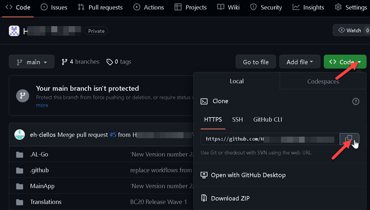

Open a new VSCode window and clone the repository locally. (You can also use the command line to clone the repository.)

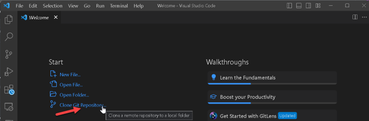

Or you can do it via CTRL+Shift+P and type Git: Clone

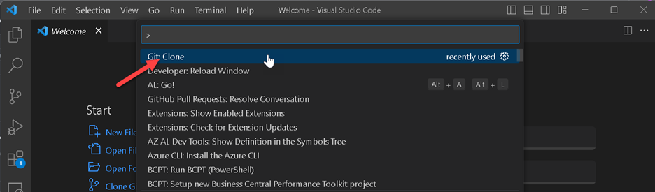

Paste the repository URL and hit ENTER

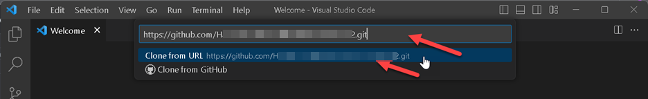

Create a new folder which will be your local repo and select it

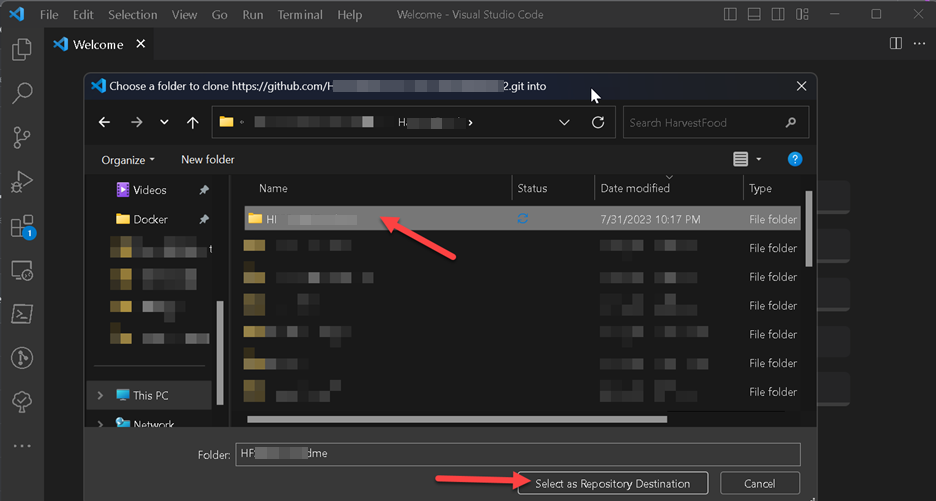

This will start the cloning

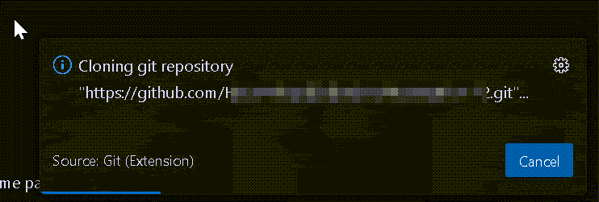

Click Open on the new pop-up window

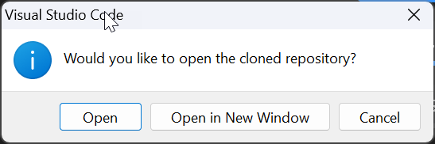

And you have to trust the authors to continue working on it

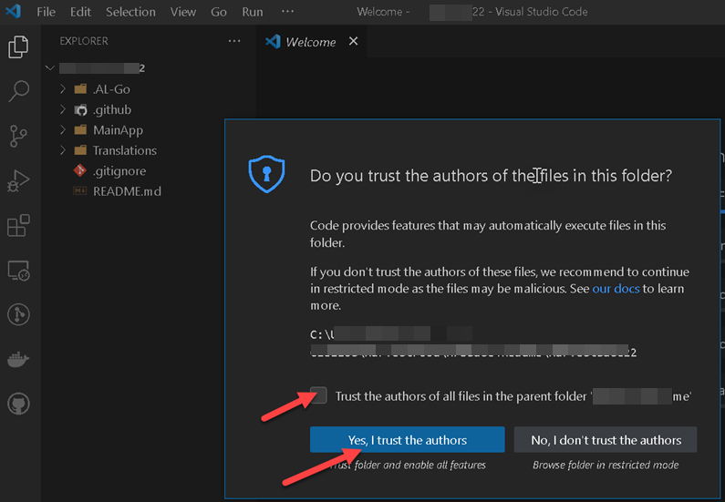

Now you can see the files in the repo.

## 5. Create your local dev environment (BC Container)

Execute `.AL-Go\localDevEnv.ps1` as below to create your first BC container:

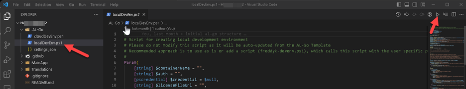

You will be asked to enter the name of the container. Enter a name and hit ENTER.

This container can be used to download symbols and publish your extension, so you can test your code before committing it to the remote repo.

You can also update the `launch.json` to include a SaaS sandbox environment. Check the Microsoft documentation on how to do it: [JSON launch file](https://learn.microsoft.com/en-us/dynamics365/business-central/dev-itpro/developer/devenv-json-launch-file).

## 6. Work on your Feature branch

When you need to add a change to your code, create a new feature branch and commit your changes there. The example below just adds records to the `.gitignore` to give the idea.

> [!NOTE]
> The screenshots use the names `new-feature` and `adding gitignore` and merge with **Create Merge Commit**. In a real project follow [BranchFlow.md](BranchFlow.md): name the branch `feature/1234-TaskDescription`, write the commit message as `AB#1234 - TaskDescription`, and merge the PR with **Squash and Merge** after the code review is approved.

### 6.1. Create a branch and commit

Make your change. The file shows up as modified (`M`) in the Explorer:

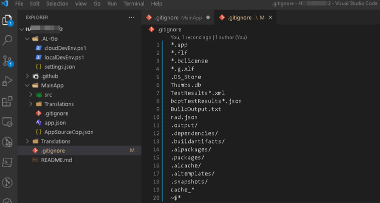

Create a new branch (Source Control → `...` → **Branch** → **Create Branch**) and enter its name:

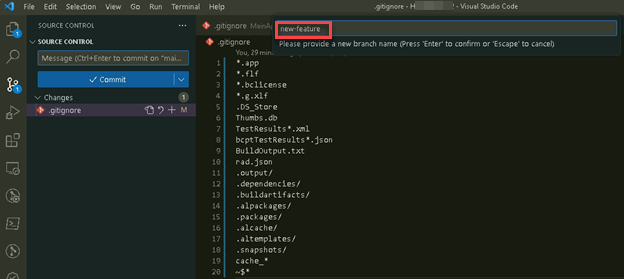

Enter a commit message and choose **Commit**:

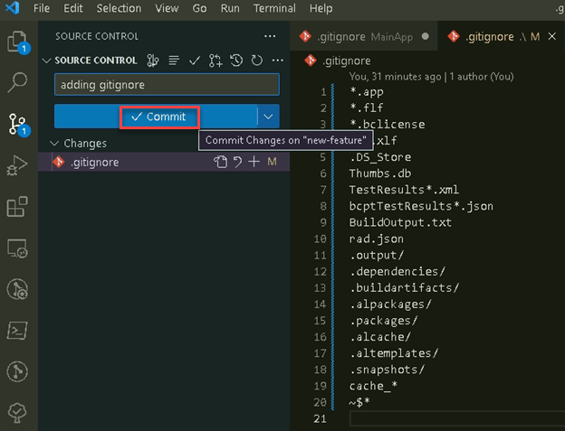

If the file has unsaved changes, choose **Save All & Commit**:

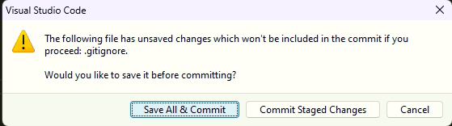

If nothing is staged yet, VSCode offers to stage all changes and commit them. Choose **Yes**:

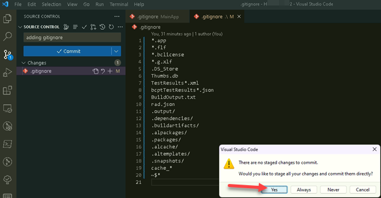

### 6.2. Publish the branch and create a Pull Request

Choose **Publish Branch** to push the new branch to GitHub:

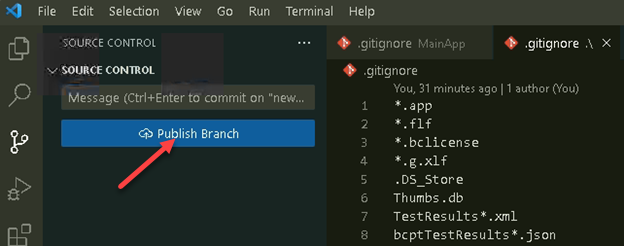

After the push, VSCode offers to create a Pull Request. Choose **Create Pull Request...**:

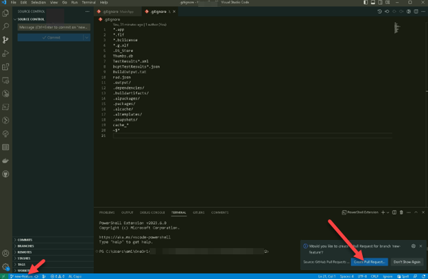

Check the source branch (your feature branch) and the target branch (`main`), fill in the title and description, and choose **Create**:

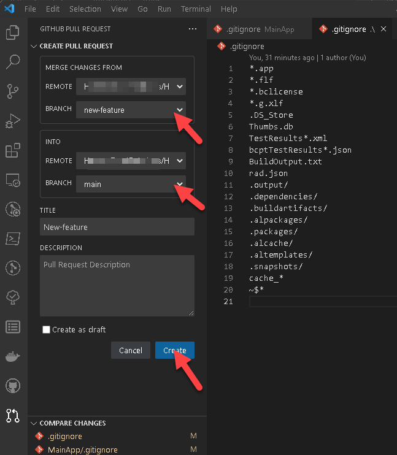

Under **Compare Changes** you can open each file and review the diff before creating the PR:

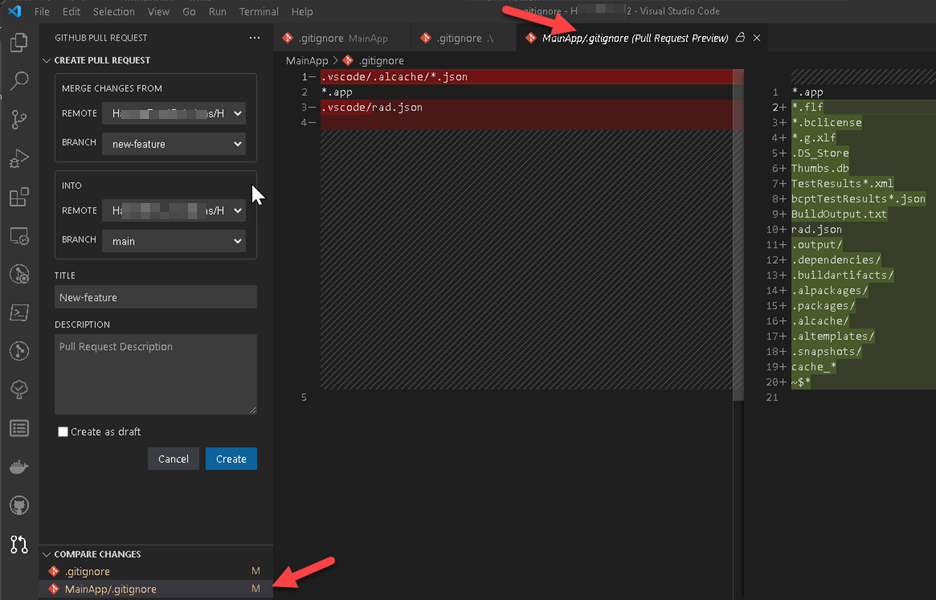

### 6.3. Merge the Pull Request

When the PR build has passed and the reviewer has approved the PR, merge it. Choose **Squash and Merge** as the merge method:

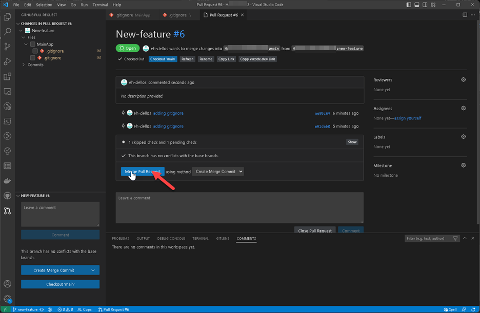

Confirm the merge commit message:

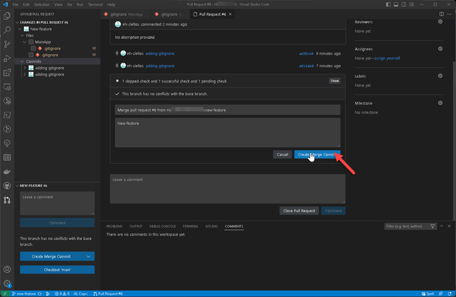

After the merge, choose **Delete branch**:

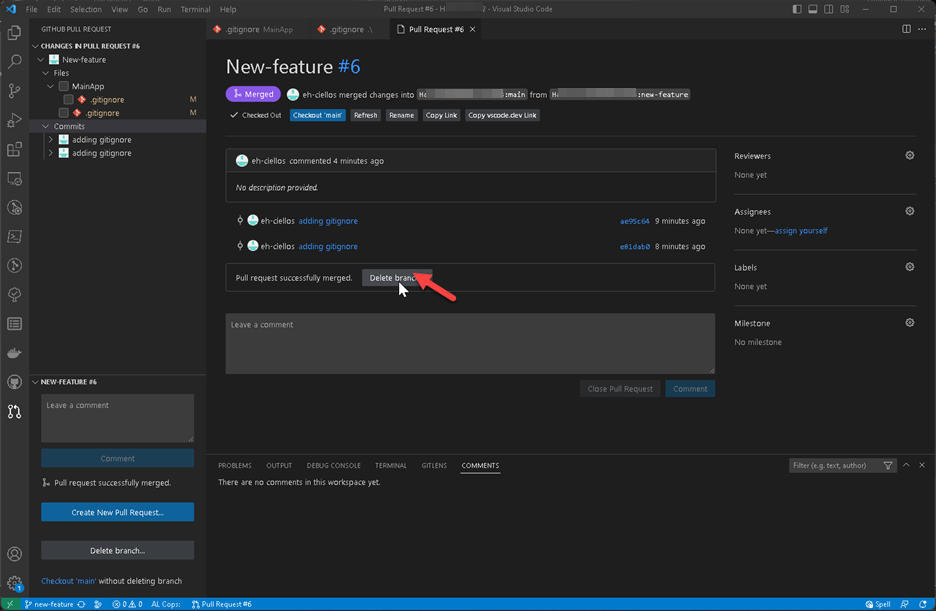

Select both the remote and the local branch and choose **OK**:

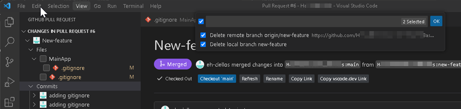

### 6.4. Check the CI/CD run

The merge to `main` starts the `CI/CD` workflow. You can follow it on the **Actions** tab in GitHub:

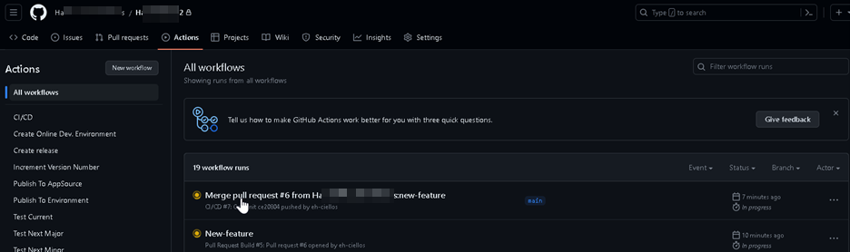

The change is now on `main` as one commit:

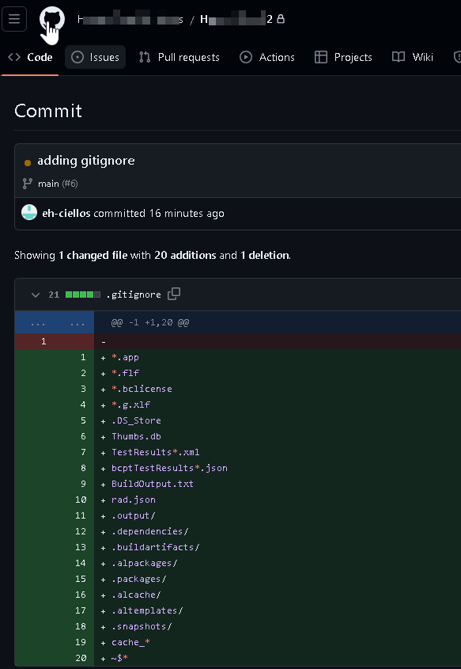
